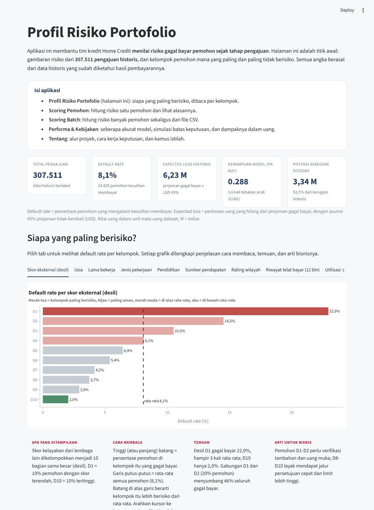
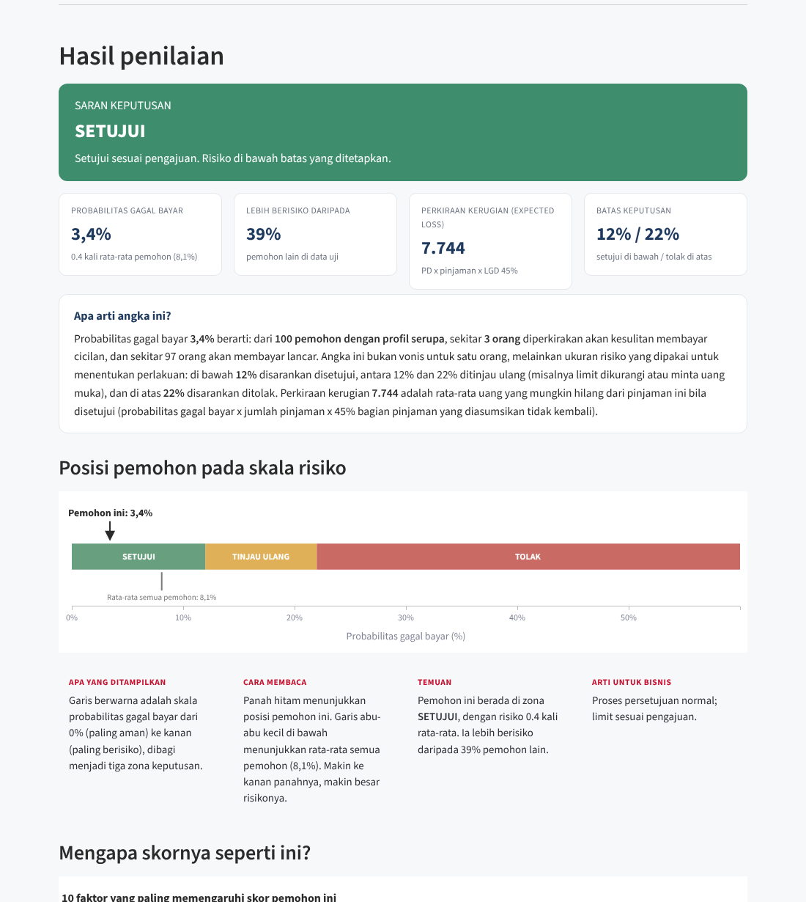
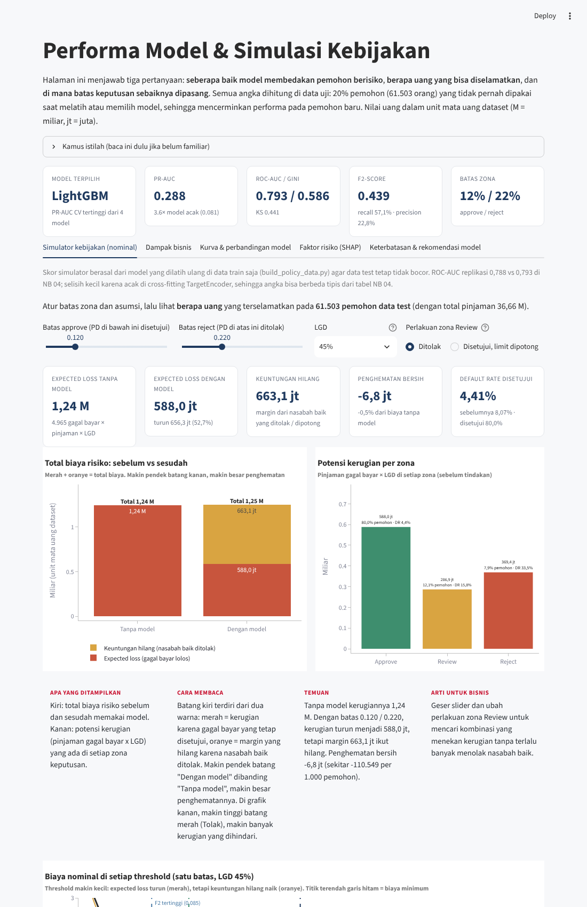
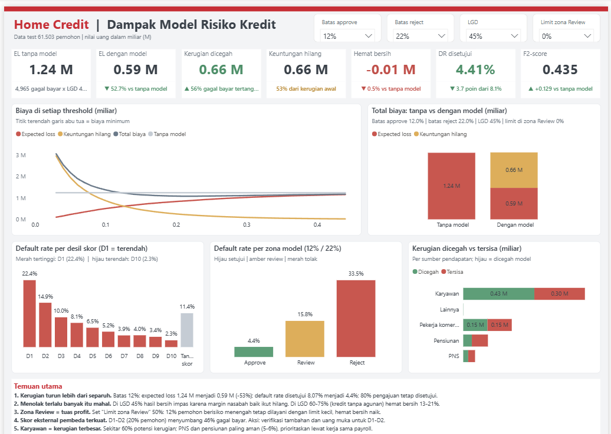
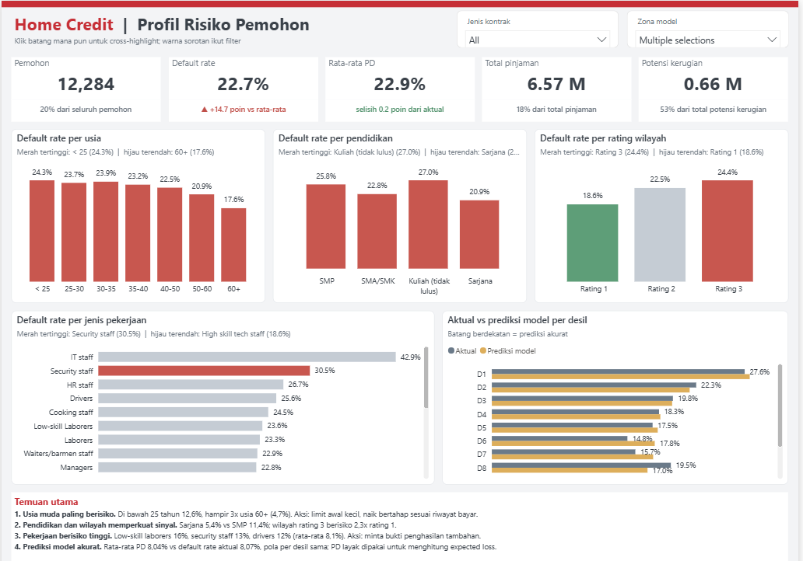

# Home Credit Credit Risk Scoring: Dari Prediksi Gagal Bayar ke Kebijakan Kredit yang Terukur dalam Uang

Proyek akhir **Home Credit Indonesia x Rakamin Academy, Data Scientist Project Based Virtual Internship**. Proyek ini membangun model probabilitas gagal bayar (probability of default, PD) dari 307.511 pemohon historis, lalu menerjemahkan skor model menjadi kebijakan tiga zona **Approve / Review / Reject** yang dampaknya diukur dalam uang. Model terpilih (LightGBM) mencapai PR-AUC 0,288 dan ROC-AUC 0,793 di data uji, menurunkan expected loss 53,7% dan default rate pinjaman yang disetujui dari 8,07% menjadi 4,34%, sambil tetap menyetujui hampir 80% pengajuan. Hasilnya dikemas dalam aplikasi Streamlit dan dashboard Power BI yang bisa dipakai oleh tim risiko maupun manajemen.


## Tautan cepat

| Hasil | Tautan |
|---|---|
| Aplikasi Streamlit (live) | https://home-credit-credit-risk-emvn4romwxnpwuyke5nquy.streamlit.app |
| Halaman portofolio | https://aoramaaulia-collab.github.io/home-credit-credit-risk/ |
| Artikel Medium | (diisi setelah terbit) |
| Presentasi (10 slide) | [HomeCredit_CreditRiskScoring.pptx](HomeCredit_CreditRiskScoring.pptx) |
| Dashboard Power BI | [powerbi/HomeCreditRisk.pbip](powerbi/HomeCreditRisk.pbip) |

## Daftar isi

1. [Ringkasan hasil](#ringkasan-hasil)
2. [Latar belakang dan masalah bisnis](#latar-belakang-dan-masalah-bisnis)
3. [Tujuan dan metrik](#tujuan-dan-metrik)
4. [Dataset](#dataset)
5. [Arsitektur dan alur proyek](#arsitektur-dan-alur-proyek)
6. [ETL](#etl)
7. [Insight EDA](#insight-eda)
8. [Preprocessing dan feature engineering](#preprocessing-dan-feature-engineering)
9. [Modeling dan eksperimen](#modeling-dan-eksperimen)
10. [Hasil evaluasi](#hasil-evaluasi)
11. [Threshold dan dampak bisnis](#threshold-dan-dampak-bisnis)
12. [Keterbatasan model](#keterbatasan-model)
13. [Rekomendasi](#rekomendasi)
14. [Aplikasi Streamlit](#aplikasi-streamlit)
15. [Dashboard Power BI](#dashboard-power-bi)
16. [Struktur folder](#struktur-folder)
17. [Cara menjalankan](#cara-menjalankan)
18. [Tech stack](#tech-stack)
19. [Referensi](#referensi)
20. [Penulis](#penulis)

---

## Ringkasan hasil

| Item | Hasil (data uji 20%, 61.503 pemohon) |
|---|---|
| Model terpilih | LightGBM, dibandingkan dengan Logistic Regression, Random Forest, dan XGBoost |
| PR-AUC | 0,288 (CV 0,280), sekitar 3,6 kali tebakan acak (0,081) |
| ROC-AUC / Gini / KS / Brier | 0,793 / 0,586 / 0,441 / 0,0655 |
| F2-score pada batas 12% | 0,439 (recall 57,1%, precision 22,8%, 20,2% pengajuan tersaring) |
| Default rate pinjaman disetujui | turun dari 8,07% menjadi 4,34%, dengan 79,8% pengajuan tetap disetujui |
| Expected loss (LGD 45%) | turun 53,7%, dari 1,24 M menjadi 0,57 M unit mata uang dataset |
| Kebijakan 3 zona | Approve 79,8% (DR 4,3%), Review 12,2% (DR 15,7%), Reject 8,0% (DR 33,6%, menangkap 33,3% seluruh gagal bayar) |
| Penghematan bersih | impas pada LGD 45%; 13,2% pada LGD 60% dan sekitar 21% pada LGD 75% |

> Catatan nilai uang: dataset tidak menyebut negara atau mata uang, sehingga semua nilai uang ditulis dalam **unit mata uang dataset**. M berarti miliar.

---

## Latar belakang dan masalah bisnis

Perusahaan pembiayaan seperti Home Credit melayani banyak pemohon yang belum punya riwayat kredit panjang. Setiap pengajuan harus diputuskan dengan cepat, dan setiap keputusan bisa salah dengan dua cara:

| Jenis kesalahan | Artinya | Biaya |
|---|---|---|
| **False Negative (FN)** | Calon gagal bayar disetujui | `pinjaman x LGD` |
| **False Positive (FP)** | Nasabah baik ditolak | `pinjaman / 2 x margin bunga bersih 13,6% x tenor (tahun)` |

Pada biaya FP, pinjaman dibagi dua karena pokok dicicil, sehingga rata-rata saldo yang menghasilkan bunga selama tenor kira-kira setengah dari pokok awal.

- **Skala masalah.** Dari 307.511 pemohon historis berlabel, 24.825 (8,07%) mengalami kesulitan membayar. Total pinjaman 184,2 M, dengan expected loss historis (pinjaman gagal bayar x LGD 45%) sebesar 6,23 M.
- **Margin 13,6%** dihitung dari pendapatan bunga bersih Rp1.261.790 juta dibagi volume pembiayaan Rp9,3 triliun (Laporan Keberlanjutan Home Credit Indonesia 2023; Kontan, 12 Februari 2024).
- **LGD tidak dipublikasikan.** Skenario dasar 45% adalah batas bawah konservatif yang mengacu pada pendekatan foundation IRB Basel untuk eksposur senior tanpa agunan. Skenario 60% dan 75% juga diuji.
- **Hasilnya, satu FN 3,7 sampai 6,1 kali lebih mahal daripada satu FP.** Model harus lebih fokus menangkap calon gagal bayar, tetapi menolak nasabah baik juga ada harganya.

---

## Tujuan dan metrik

**Tujuan:** membangun model PD dan kebijakan keputusan Approve / Review / Reject yang dampaknya bisa diukur dalam uang.

| Metrik | Peran | Alasan |
|---|---|---|
| **F2-score** | Metrik utama untuk memilih threshold | Recall dibobot 4 kali precision karena FN jauh lebih mahal daripada FP |
| **PR curve / PR-AUC** | Metrik utama untuk memilih model | Data tidak seimbang (92:8). PR curve fokus pada kelas gagal bayar, sedangkan ROC bisa terlihat bagus karena terbantu banyaknya nasabah lancar (Saito & Rehmsmeier, 2015). Patokan acak = 0,081 |
| ROC-AUC, Gini, KS | Pembanding | Ukuran standar industri kredit untuk daya pembeda |
| Brier score | Pembanding | Mengukur akurasi probabilitas, penting karena PD dipakai untuk menghitung nominal kerugian |
| Total biaya (expected loss + keuntungan hilang) | Guardrail bisnis | Threshold tidak boleh membuat total biaya lebih buruk daripada tanpa model |

Akurasi sengaja tidak dipakai: model yang selalu menjawab "lancar" sudah mendapat akurasi sekitar 92% tanpa menangkap satu pun calon gagal bayar.

---

## Dataset

Dataset diberikan oleh program dan terdiri dari 7 tabel dengan total sekitar **2,7 GB CSV**.

| Tabel | Isi |
|---|---|
| `application_train` / `application_test` | Data pengajuan utama per pemohon (train berlabel `TARGET`, 307.511 baris) |
| `bureau` | Riwayat kredit pemohon di lembaga keuangan lain |
| `bureau_balance` | Status bulanan setiap kredit di `bureau` |
| `previous_application` | Pengajuan sebelumnya di Home Credit, termasuk yang ditolak |
| `installments_payments` | Riwayat pembayaran cicilan pinjaman sebelumnya (tepat waktu atau telat) |
| `POS_CASH_balance` | Saldo bulanan pinjaman barang (POS) dan pinjaman tunai sebelumnya |
| `credit_card_balance` | Saldo dan pemakaian bulanan kartu kredit sebelumnya |

---

## Arsitektur dan alur proyek


| Tahap | File | Isi |
|---|---|---|
| 1. Business understanding | `01_business_understanding.ipynb` | Masalah, KPI, biaya FN vs FP, pemilihan metrik F2 dan PR curve |
| 2. ETL | `02_etl.ipynb`, `src/sql_v2.py` | CSV ke Parquet (staging) ke BigQuery; data mart riwayat kredit dengan SQL |
| 3. EDA | `03_eda.ipynb` | Profiling, kualitas data, uji statistik (Mann-Whitney, chi-square, IV, VIF), business insight |
| 4. Modeling | `04_modeling.ipynb`, `src/features.py` | Pipeline preprocessing, eksperimen class weight, tuning 4 model, seleksi fitur, threshold F2 + guardrail biaya, dampak bisnis nominal, SHAP, fairness |
| 5. Aplikasi | `streamlit_app.py`, `app/` | Scoring pemohon, scoring batch CSV, simulator kebijakan nominal |
| 6. Dashboard | `powerbi/HomeCreditRisk.pbip` | Dashboard Power BI (format PBIP) dengan simulasi threshold, LGD, dan limit zona Review |

---

## ETL

```
CSV mentah (7 tabel, 2,7 GB)
   -> Parquet staging (sekitar 8x lebih kecil, tipe data tersimpan)
   -> BigQuery Sandbox (dataset home_credit_raw)
   -> SQL data mart (dataset home_credit_mart, 1 baris per SK_ID_CURR)
   -> Python (EDA dan modeling)
```

| Langkah | Alasan |
|---|---|
| CSV ke Parquet | Format kolom terkompresi, sekitar 8 kali lebih kecil, lebih cepat dibaca, dan tipe data tidak perlu ditebak ulang |
| Parquet ke BigQuery | Tabel riwayat berisi jutaan baris; agregasi lebih efisien di gudang data daripada di memori laptop |
| SQL data mart | Semua riwayat diringkas menjadi satu baris per pemohon. Logika agregasi tersimpan sebagai SQL yang mudah dibaca dan diaudit |
| Uji lokal dengan DuckDB | Query yang sama diuji lokal dulu agar kesalahan logika ketahuan sebelum memakai kuota BigQuery |

Data mart versi akhir (v2) berisi **184 kolom per pemohon**. Contoh fitur riwayat: persentase cicilan telat 12 bulan terakhir, utilisasi kartu kredit, total utang aktif di lembaga lain, dan jumlah penolakan pengajuan sebelumnya.

---

## Insight EDA

### Insight 1: skor eksternal adalah pembeda terkuat


Default rate turun konsisten dari 22,9% di desil terendah (D1) menjadi 2,0% di desil tertinggi (D10). **20% pemohon berskor terendah (D1-D2) menyumbang 46% seluruh gagal bayar.** Skor ini juga memiliki Information Value tertinggi (0,61).

**Aksi bisnis:** verifikasi tambahan dan uang muka untuk D1-D2; jalur persetujuan cepat untuk D8-D10.

### Insight 2: sinyal terlilit utang


| Sinyal | Kelompok terendah | Kelompok tertinggi | Kenaikan |
|---|---|---|---|
| Utilisasi kartu kredit | 0%: DR 5,4% | di atas 90%: DR 19,3% | 3,6 kali |
| Pinjaman aktif di lembaga lain | 0: DR 5,7% | 6 atau lebih: DR 13,4% | 2,4 kali |
| Riwayat telat 12 bulan | tidak pernah: DR 6,7% | telat di atas 15% cicilan: DR 13,0% | hampir 2 kali |

**Aksi bisnis:** sesuaikan limit atau tenor (zona Review), bukan langsung menolak, karena sebagian besar kelompok ini tetap membayar.

### Temuan lain

| Dimensi | Temuan |
|---|---|
| Usia | di bawah 25 tahun 12,6% vs 60 tahun ke atas 4,7% |
| Pendidikan | sarjana 5,4% vs SMP 11,4% |
| Wilayah | rating wilayah 3 berisiko 2,3 kali rating 1 |
| Pekerjaan | low-skill laborers 16%, security staff 13%, drivers 12%; PNS dan pensiunan 5-6% |
| Produk | pinjaman tunai 8,3% vs revolving 5,6% |

---

## Preprocessing dan feature engineering

### Pembersihan data

| Masalah | Penanganan |
|---|---|
| `DAYS_EMPLOYED = 365243` (kode pensiunan / tidak bekerja) | Diubah menjadi kosong + penanda `IS_NOT_EMPLOYED` |
| `CODE_GENDER = XNA`, `NAME_FAMILY_STATUS = Unknown` | Diubah menjadi kosong |
| `ORGANIZATION_TYPE = XNA` | Diubah menjadi "Not employed" |
| Pemohon tanpa riwayat di tabel tertentu | Diisi 0 + penanda `HAS_BUREAU`, `HAS_PREV`, `HAS_CC` |

### Pencegahan leakage

- Kolom yang diperbarui setelah pengajuan dibuang (contoh: `DAYS_CREDIT_UPDATE` di tabel bureau).
- Kode 365243 di `previous_application` dianggap kosong.
- Data dibagi **80/20 secara stratified sebelum model mempelajari apa pun**; evaluasi selama pengembangan memakai cross-validation 3-fold di data latih.
- Seluruh transformasi berada di dalam pipeline, sehingga statistik (median, batas winsorizing, target encoding) dihitung ulang di setiap lipatan CV.

### Fitur baru

| Kelompok | Fitur |
|---|---|
| Skor eksternal | `EXT_SOURCE_MEAN`, `EXT_SOURCE_MIN`, `EXT_SOURCE_NA_CNT` |
| Usia dan pekerjaan | `AGE_YEARS`, `EMPLOYED_YEARS`, `EMPLOYED_TO_AGE` |
| Kemampuan bayar | `ANNUITY_INCOME`, `CREDIT_INCOME`, `INCOME_PER_PERSON`, `BUREAU_DEBT_INCOME` |
| Struktur pinjaman | `CREDIT_GOODS`, `CREDIT_TERM` (perkiraan tenor), `HAS_DOWN_PAYMENT` |
| Kelengkapan dan stabilitas | `DOC_COUNT`, `ADDRESS_MISMATCH_CNT`, lama sejak ganti HP, alamat, dan KTP |

### Kolom yang dibuang

| Kolom | Alasan |
|---|---|
| `CODE_GENDER` | Keadilan dan perlindungan konsumen (POJK 22/2023) |
| `AMT_GOODS_PRICE` | Redundan dengan `AMT_CREDIT` (VIF 115); disimpan sebagai rasio `CREDIT_GOODS` |
| `REGION_RATING_CLIENT` | Redundan (VIF 10,7) |
| `FLAG_MOBIL`, `FLAG_CONT_MOBILE` | Hampir konstan |
| Jam dan hari pengajuan | Atribut proses, bukan karakter pemohon |
| 28 kolom bangunan `_MODE` / `_MEDI` | Korelasi di atas 0,99 dengan versi `_AVG` |
| `OBS_60` / `DEF_60` | Redundan dengan versi 30 hari |
| 20 kolom `FLAG_DOCUMENT` | Diringkas menjadi `DOC_COUNT` |

Total fitur model: **142**.

### Pipeline preprocessing (scikit-learn `ColumnTransformer`)

| Jenis kolom | Transformasi |
|---|---|
| Numerik miring | Imputasi median, winsorizing p1-p99, `log1p`, `StandardScaler` |
| Numerik ber-outlier | Imputasi median, `RobustScaler` |
| Numerik lainnya | Imputasi median, `StandardScaler` |
| Kolom dengan nilai kosong | `MissingIndicator` |
| Biner | passthrough |
| Pendidikan | Ordinal encoding |
| Kategori dengan 10 nilai atau kurang | One-hot encoding |
| `OCCUPATION_TYPE`, `ORGANIZATION_TYPE` | `TargetEncoder` cross-fitted |

---

## Modeling dan eksperimen

### Perbandingan model (prediksi out-of-fold, data latih)


| Model | PR-AUC (CV) | Keterangan |
|---|---|---|
| Tebakan acak | 0,081 | Patokan = proporsi gagal bayar |
| Aturan skor eksternal | 0,188 | Pembanding sederhana tanpa machine learning |
| Random Forest | 0,252 | |
| Logistic Regression | 0,261 | |
| XGBoost | 0,279 | |
| **LightGBM** | **0,280** | **Terpilih** |
| Ensemble | 0,280 | Tidak diadopsi, tambahan terlalu kecil untuk kerumitannya |

### Eksperimen dan keputusan

| Eksperimen | Hasil | Keputusan |
|---|---|---|
| Class weight (semua model) | PR-AUC tidak naik, Brier score 2,5-3 kali lebih buruk | Tidak dipakai; ketidakseimbangan ditangani lewat threshold |
| Tuning `RandomizedSearchCV` (LR 15, RF 10, LightGBM 30, XGBoost 20 kombinasi), metrik `average_precision`, termasuk parameter preprocessing | LightGBM terbaik | Dipakai |
| Seleksi fitur `SelectFromModel` di dalam CV, top 100 | PR-AUC turun 0,002 | Tidak dipakai |
| Seleksi fitur, top 60 | PR-AUC turun 0,006 | Tidak dipakai |
| 5 fitur tambahan | PR-AUC naik 0,001 (di bawah batas adopsi 0,002) | Tidak dipakai |
| Menambahkan gender | PR-AUC naik 0,002 | Tetap dikeluarkan demi keadilan |

**Hyperparameter LightGBM terbaik:** `n_estimators` 1600, `learning_rate` 0,03, `num_leaves` 15, `max_depth` 6, `min_child_samples` 50, `subsample` 0,7, `colsample_bytree` 0,3, `reg_alpha` 5, `reg_lambda` 10, `min_split_gain` 0,1. Pohon kecil, laju belajar pelan, dan regularisasi kuat menandakan sinyal di data ini halus dan mudah ter-overfit.

---

## Hasil evaluasi

Evaluasi akhir dilakukan pada **20% data uji (61.503 pemohon)** yang tidak pernah dipakai untuk melatih maupun memilih model.

| Metrik | Nilai |
|---|---|
| PR-AUC | 0,288 (CV 0,280) |
| ROC-AUC | 0,793 |
| Gini | 0,586 |
| KS | 0,441 |
| Brier score | 0,0655 |
| F2 / recall / precision pada batas 12% | 0,439 / 57,1% / 22,8% |

**Kalibrasi sudah dicek** (notebook 04 bagian 14.1). Pada 10 kelompok pemohon, kurva kalibrasi menempel garis diagonal dan Brier score di data uji 0,0655. Artinya angka PD bisa dibaca langsung sebagai peluang gagal bayar dan aman dipakai untuk menghitung expected loss, sehingga kalibrasi ulang (isotonic atau Platt) tidak diperlukan. Ini hasil dari keputusan tidak memakai class weight.


Garis biru tua PR curve berada jauh di atas garis acak (0,081) di sepanjang kurva. Titik hitam adalah batas 12% yang dipilih.


| | Diprediksi lancar | Diprediksi gagal bayar |
|---|---|---|
| **Aktual lancar** | 46.959 benar disetujui | 9.579 nasabah baik tersaring |
| **Aktual gagal bayar** | 2.132 gagal bayar lolos | 2.833 gagal bayar tertangkap |

Model menangkap lebih dari separuh calon gagal bayar dengan menyaring sekitar seperlima pengajuan.

**Performa per produk:** Cash loans PR-AUC 0,292 dan recall 58%; Revolving loans PR-AUC 0,224 dan recall 41%.

### Interpretasi model (SHAP)


Faktor paling berpengaruh: rata-rata skor eksternal (0,247), perkiraan tenor (0,120), besar cicilan (0,117), skor eksternal 2 (0,112), pinjaman terhadap harga barang (0,111), skor eksternal 3 (0,099), lama riwayat kredit barang atau POS (0,096), lalu skor eksternal terendah, cicilan pinjaman sebelumnya, sektor tempat kerja, dan jenis pekerjaan. Urutan ini konsisten dengan temuan EDA. Tenor berpengaruh secara tidak linear, pola yang sulit ditangkap model linear.

---

## Threshold dan dampak bisnis

### Perbandingan kebijakan (data uji, LGD 45%)


| Kebijakan | Disetujui | DR disetujui | Expected loss | Keuntungan hilang | Total biaya | vs tanpa model |
|---|---|---|---|---|---|---|
| Tanpa model | 100% | 8,07% | 1,24 M | 0 | 1,24 M | - |
| Aturan skor eksternal | 90,1% | 6,34% | 0,92 M | 0,30 M | 1,22 M | hemat 1,6% |
| F2 tertinggi (9%) | 72,1% | 3,61% | 0,44 M | 1,01 M | 1,45 M | biaya naik 16,8% |
| **Terpilih (12%)** | **79,8%** | **4,34%** | **0,57 M** | **0,67 M** | **1,24 M** | **impas (-0,2%)** |
| Biaya minimum (22%) | 92,0% | 5,85% | 0,87 M | 0,20 M | 1,07 M | hemat 13,7% |


**Aturan pemilihan:** F2 tertinggi dengan guardrail, yaitu total biaya tidak boleh lebih buruk daripada tanpa model.

- **Bukan F2 tertinggi (9%)** karena menolak 13.808 nasabah baik; margin yang hilang lebih besar daripada kerugian yang dicegah.
- **Bukan biaya minimum (22%)** karena recall-nya hanya sekitar 32% dan sangat bergantung pada asumsi margin dan LGD.
- **Batas 12% terpilih:** expected loss turun 53,7% (0,67 M dicegah di data uji, sekitar 3,3 M bila diterapkan ke seluruh 307 ribu pemohon historis).

### Sensitivitas LGD

| LGD | Penghematan bersih threshold 12% |
|---|---|
| 45% (skenario dasar, konservatif) | impas (-0,2%) |
| 60% | 13,2% |
| 75% | sekitar 21% |

### Kebijakan 3 zona


| Zona | Batas PD | Porsi pemohon | Default rate | Porsi dari seluruh gagal bayar | Perlakuan |
|---|---|---|---|---|---|
| Approve | di bawah 12% | 79,8% | 4,3% | 42,9% | Disetujui, jalur cepat |
| Review | 12% sampai di bawah 22% | 12,2% | 15,7% | 23,7% | Limit dikurangi, tenor diperpendek, atau uang muka |
| Reject | 22% ke atas | 8,0% | 33,6% | 33,3% | Ditolak |

---

## Keterbatasan model

1. **Batas informasi data.** PR-AUC 0,288 terlihat kecil, tetapi patokan acaknya hanya 0,081 karena gagal bayar hanya 8%. ROC-AUC 0,79 setara solusi kuat pada dataset ini (sekitar 0,80 untuk solusi publik terbaik). Penambahan fitur, seleksi fitur, ensemble, dan tuning luas hanya menggeser PR-AUC sekitar 0,002, tanda model sudah mendekati batas informasi data.
2. **Precision rendah adalah konsekuensi data tidak seimbang.** Dari 4 pemohon yang tersaring, 1 benar-benar gagal bayar, tetapi kelompok ini 2,8 kali lebih berisiko daripada rata-rata. Karena itu sebagian besar masuk zona Review, bukan ditolak.
3. **Bias seleksi.** Label hanya ada untuk pemohon yang dulu disetujui (tanpa reject inference), sehingga risiko profil yang dulu ditolak bisa diremehkan.
4. **Validasi acak, bukan out-of-time.** Dataset tidak punya tanggal pengajuan; ketahanan terhadap perubahan kondisi ekonomi belum teruji.
5. **Revolving loans lebih lemah** (PR-AUC 0,224, recall 41%) karena jumlah datanya kecil (sekitar 9%).
6. **Asumsi bisnis.** LGD dan margin adalah proksi; nilai nominal dampak bergantung pada asumsi ini, karena itu diuji 3 skenario.
7. **Reproducibility.** TargetEncoder memakai cross-fitting acak; replikasi di lingkungan lain memberi ROC-AUC 0,788 vs 0,793.
8. **Keadilan.** Gender dikeluarkan, tetapi variabel proksi (usia, status keluarga, pekerjaan) masih ada dan perlu audit fairness.
9. **Ketergantungan pada skor eksternal.** Skor ini adalah kotak hitam dari lembaga lain dan mendominasi model; jika sumbernya berubah, performa ikut berubah.

---

## Rekomendasi

### Rekomendasi bisnis

1. Terapkan 3 zona dengan batas 12% / 22% sebagai filter awal dan tinjau batasnya setiap kuartal.
2. Zona Review: limit dikurangi (misalnya 50%), tenor lebih pendek, atau uang muka, untuk menjaga margin sambil menekan risiko.
3. Prioritaskan segmen aman: skor D8-D10, PNS, dan pensiunan (misalnya lewat kerja sama payroll).
4. Lakukan verifikasi tambahan untuk D1-D2 dan pemohon dengan utilisasi kartu kredit di atas 90% atau 6 pinjaman aktif atau lebih.
5. Pantau default rate per zona setiap bulan.

### Rekomendasi pengembangan model

1. **Data baru:** riwayat SLIK OJK yang lebih rinci, data alternatif (pembayaran tagihan, e-wallet, telco), dan pendapatan terverifikasi. Ini cara paling efektif menaikkan PR-AUC.
2. Validasi out-of-time dan monitoring PSI/CSI bulanan; retraining terjadwal saat label 12 bulan tersedia.
3. Reject inference atau eksperimen champion-challenger kecil untuk mendapat label dari profil yang biasanya ditolak.
4. Model atau threshold terpisah per produk (cash vs revolving) dan per segmen.
5. Monotonic constraints (contoh: skor eksternal naik, risiko turun) dan scorecard WOE + Logistic Regression sebagai challenger yang mudah diaudit regulator.
6. Tuning Bayesian (Optuna) dengan early stopping dan 5-fold; mencoba CatBoost untuk variabel kategori.
7. Objective berbasis profit (cost-sensitive) memakai LGD dan EAD aktual internal.
8. Audit fairness (approval rate dan error per kelompok usia dan proksi) serta alasan penolakan per nasabah dari SHAP (adverse action reason).
9. MLOps: model registry, API scoring, dan A/B rollout bertahap.

---

## Aplikasi Streamlit

Aplikasi live: https://home-credit-credit-risk-emvn4romwxnpwuyke5nquy.streamlit.app

| Halaman | Fungsi |
|---|---|
| **Beranda** | Profil risiko portofolio dari 307.511 pengajuan historis: KPI utama dan default rate per segmen (tab per dimensi) beserta temuan singkat |
| **Scoring Pemohon** | Pilih sumber data: cari pemohon terdaftar berdasarkan ID (lengkap dengan seluruh riwayat kreditnya) atau isi data utama secara manual. Hasilnya PD, zona keputusan yang disarankan, dan faktor SHAP yang menaikkan atau menurunkan risiko |
| **Scoring Batch (CSV)** | Unggah file CSV berformat data mart untuk menilai banyak pemohon sekaligus; kolom yang tidak ada dianggap kosong dan ditangani pipeline. Hasil bisa diunduh sebagai CSV |
| **Performa & Kebijakan** | Simulator kebijakan nominal (batas approve dan reject, LGD, potongan limit zona Review), dampak bisnis, kurva dan perbandingan model, serta faktor risiko SHAP |
| **Tentang** | Ringkasan metodologi, sumber data, dan cara membaca hasil |

**Cara memakai:** buka halaman Scoring Pemohon, pilih "Pemohon terdaftar (cari ID)" lalu masukkan ID, atau pilih "Input manual" dan isi data pengajuan, profil, pekerjaan, serta skor eksternal. Untuk melihat dampak kebijakan, buka Performa & Kebijakan dan geser batas zona serta asumsi LGD.

Catatan: skor di simulator berasal dari model yang dilatih ulang di data latih saja (`build_policy_data.py`), sehingga data uji tetap tidak bocor.

| Beranda | Scoring Pemohon | Performa & Kebijakan |
|---|---|---|
|  |  |  |

---

## Dashboard Power BI

Dashboard dibuat dalam format **PBIP** (Power BI Project) sehingga definisi laporan dan model semantik tersimpan sebagai file teks yang bisa dilacak di Git.

| Halaman | Isi |
|---|---|
| **Ringkasan Kebijakan** | KPI nominal (expected loss, keuntungan hilang, total biaya) dengan pembanding interaktif, kurva biaya per threshold, dan perbandingan sebelum vs sesudah model |
| **Segmen & Zona** | Distribusi pemohon dan default rate per zona serta per segmen |
| **Profil Risiko Pemohon** | Default rate menurut usia, pendidikan, pekerjaan, wilayah, dan atribut pemohon lainnya |

**Interaktivitas:**

- **Slicer** threshold approve/reject, LGD, dan persentase limit zona Review; seluruh KPI dan kurva dihitung ulang mengikuti pilihan.
- **Sorotan warna dinamis:** merah untuk default rate tertinggi dan hijau untuk yang terendah, menyesuaikan filter aktif.
- **Pembanding KPI** yang menunjukkan selisih terhadap kondisi tanpa model.
- **Tombol navigasi** antarhalaman.

**Cara membuka:**

1. Buka `powerbi/HomeCreditRisk.pbip` di Power BI Desktop.
2. Jika lokasi folder berbeda dari komputer pembuat, buka **Transform data > Manage parameters**, lalu ubah parameter `DataFolder` menjadi path lengkap folder `powerbi/data` di komputer Anda.
3. Klik **Close & Apply**, lalu **Refresh**.

| Ringkasan Kebijakan | Segmen & Zona | Profil Risiko Pemohon |
|---|---|---|
|  |  |  |

---

## Struktur folder

```
home-credit-credit-risk/
├── 01_business_understanding.ipynb   masalah bisnis, biaya FN vs FP, pemilihan metrik
├── 02_etl.ipynb                      CSV -> Parquet -> BigQuery -> SQL data mart
├── 03_eda.ipynb                      EDA, uji statistik, business insight
├── 04_modeling.ipynb                 pipeline, eksperimen, tuning, threshold, dampak bisnis, SHAP
├── streamlit_app.py                  titik masuk aplikasi Streamlit
├── build_app_data.py                 menyiapkan data ringan untuk aplikasi
├── build_policy_data.py              skor data uji untuk simulator kebijakan dan Power BI
├── requirements.txt
├── app/                              halaman Streamlit (beranda, scoring, batch, model, tentang)
├── app_data/                         data ringan aplikasi (agregat segmen, pemohon application_test, skor data uji)
├── models/                           model final (joblib), metadata, artefak evaluasi
├── src/
│   ├── features.py                   cleaning, feature engineering, preprocessing
│   └── sql_v2.py                     query SQL data mart v2
├── powerbi/
│   ├── HomeCreditRisk.pbip           proyek Power BI
│   ├── HomeCreditRisk.Report/        definisi laporan
│   ├── HomeCreditRisk.SemanticModel/ model semantik (measure DAX, parameter DataFolder)
│   ├── data/                         data CSV untuk dashboard
│   └── build_pbip.py, export_data.py skrip pembangun
├── HomeCredit_CreditRiskScoring.pptx  presentasi 10 slide
├── docs/                             halaman portofolio (GitHub Pages) dan gambar
│   └── assets/                       grafik dan screenshot aplikasi
└── data/                             tidak di-push (dibuat ulang lewat notebook 02)
```

---

## Cara menjalankan

### 1. Aplikasi Streamlit (paling mudah)

```bash
git clone https://github.com/aoramaaulia-collab/home-credit-credit-risk.git
cd home-credit-credit-risk
pip install -r requirements.txt
python -m streamlit run streamlit_app.py
```

Model dan data ringan aplikasi sudah tersedia di `models/` dan `app_data/`, jadi aplikasi bisa langsung dijalankan tanpa dataset mentah.

### 2. Seluruh proyek dari awal

Jalankan notebook secara berurutan:

1. `01_business_understanding.ipynb`
2. `02_etl.ipynb` (membutuhkan dataset mentah dan BigQuery, lihat di bawah)
3. `03_eda.ipynb`
4. `04_modeling.ipynb`

Setelah itu jalankan `python build_app_data.py` dan `python build_policy_data.py` untuk memperbarui data aplikasi dan simulator.

### 3. Menyiapkan BigQuery untuk notebook 02

File kredensial `gcp-key.json` **tidak disertakan** di repo (sudah masuk `.gitignore`). Untuk menjalankan ETL sendiri:

1. Letakkan 7 file CSV dataset di folder `home-credit-default-risk` yang sejajar dengan folder repo, atau ubah variabel `RAW_DIR` di notebook.
2. Buat project di Google Cloud Console dan aktifkan BigQuery (BigQuery Sandbox gratis sudah cukup).
3. Buat service account dengan peran BigQuery Data Editor dan BigQuery Job User, lalu unduh key JSON-nya.
4. Simpan key tersebut di folder proyek dengan nama `gcp-key.json`.
5. Ganti `PROJECT_ID` di notebook dengan Project ID Anda. Dataset `home_credit_raw` dan `home_credit_mart` dibuat otomatis.

---

## Tech stack

| Kategori | Tools |
|---|---|
| Bahasa | Python 3.12, SQL |
| Data dan ETL | pandas, PyArrow (Parquet), Google BigQuery, DuckDB |
| Analisis dan statistik | SciPy, matplotlib, seaborn |
| Machine learning | scikit-learn (Pipeline, ColumnTransformer, TargetEncoder, RandomizedSearchCV), LightGBM, XGBoost |
| Interpretasi | SHAP |
| Deployment | Streamlit, Plotly, joblib |
| Business intelligence | Power BI Desktop (PBIP, DAX) |

---

## Referensi

1. Home Credit Indonesia. *Laporan Keberlanjutan 2023* (pendapatan bunga bersih Rp1.261.790 juta).
2. Kontan, 12 Februari 2024 (volume pembiayaan Home Credit Indonesia Rp9,3 triliun).
3. Basel Committee on Banking Supervision. Internal Ratings-Based approach, foundation IRB: LGD 45% untuk eksposur senior tanpa agunan.
4. Saito, T., & Rehmsmeier, M. (2015). The Precision-Recall Plot Is More Informative than the ROC Plot When Evaluating Binary Classifiers on Imbalanced Datasets. *PLOS ONE*, 10(3).
5. Otoritas Jasa Keuangan. *POJK Nomor 22 Tahun 2023 tentang Pelindungan Konsumen dan Masyarakat di Sektor Jasa Keuangan*.
6. Lundberg, S. M., & Lee, S.-I. (2017). A Unified Approach to Interpreting Model Predictions. *NeurIPS 30*.
7. Ke, G., dkk. (2017). LightGBM: A Highly Efficient Gradient Boosting Decision Tree. *NeurIPS 30*.

---

## Penulis

**Aorama Aulia**
Data Scientist Project Based Virtual Internship, Home Credit Indonesia x Rakamin Academy

- GitHub: [aoramaaulia-collab](https://github.com/aoramaaulia-collab)
- Medium: [@aoramaaulia](https://medium.com/@aoramaaulia)
