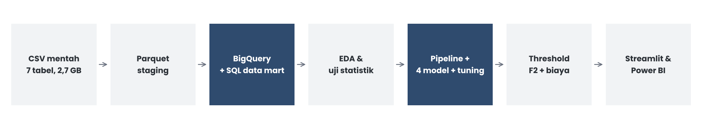
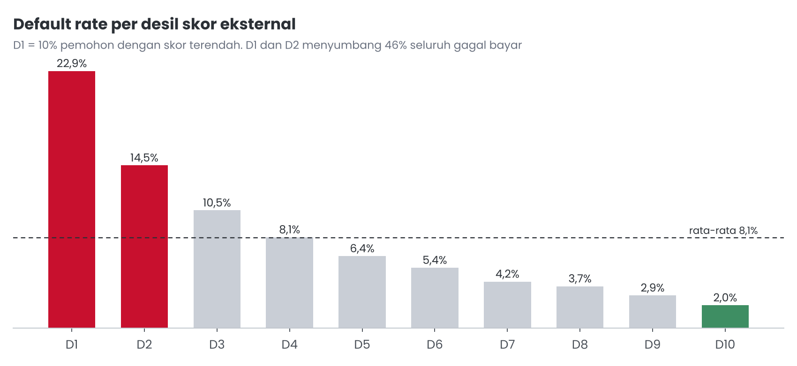
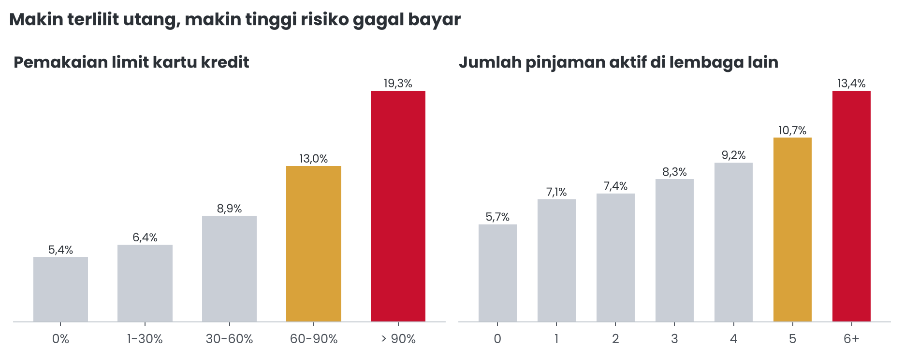
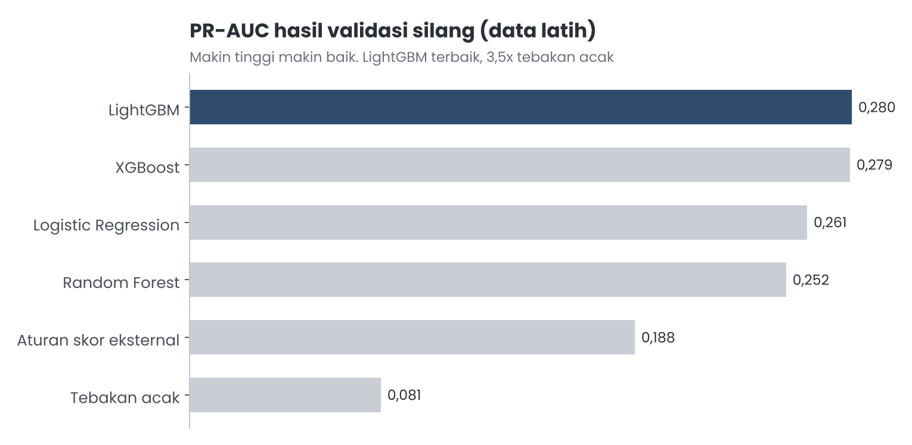
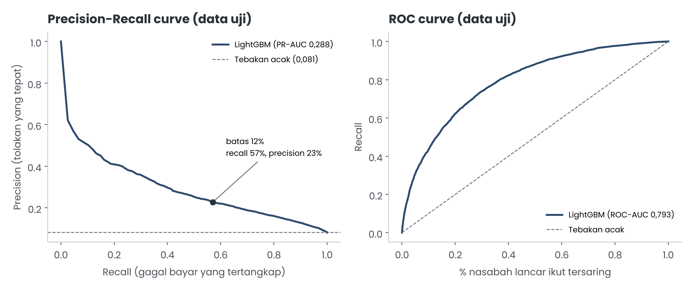
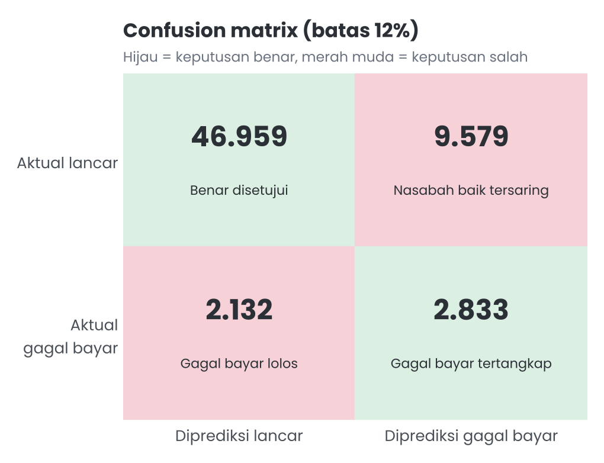
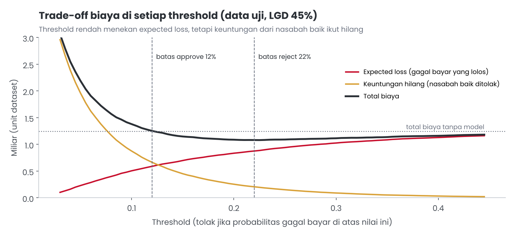
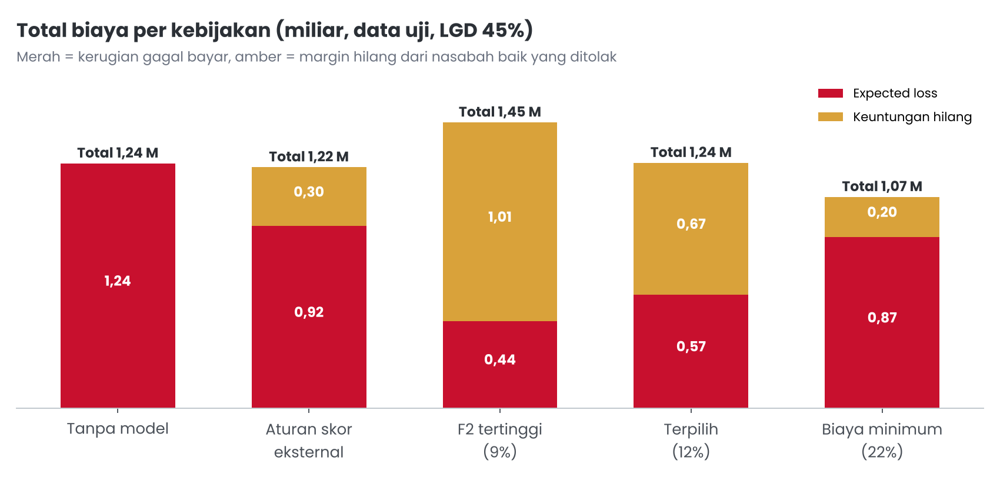
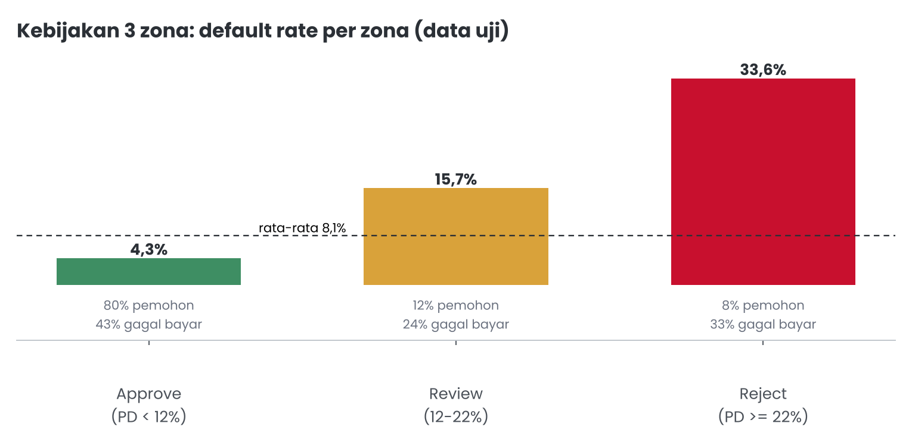
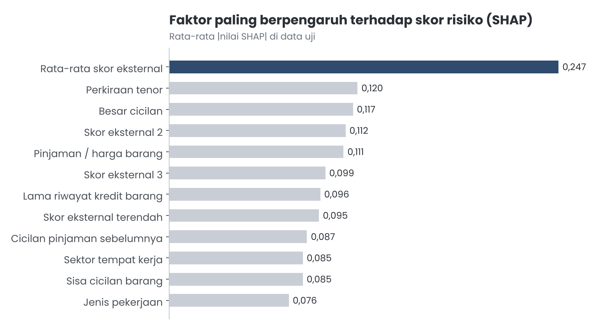

<!--
CATATAN UNTUK PENULIS (hapus sebelum terbit):
Medium tidak membaca path gambar relatif. Saat menempel artikel ini ke editor Medium,
unggah setiap gambar secara manual dari folder docs/assets/ di posisi placeholder-nya:
fig_alur.png, fig_desil.png, fig_utang.png, fig_model.png, fig_pr_roc.png, fig_cm.png,
fig_biaya_threshold.png, fig_kebijakan.png, fig_zona.png, fig_shap.png.
Baris miring di bawah setiap gambar dipakai sebagai caption gambar di Medium.
Isi juga tautan Medium di README setelah artikel terbit.
-->

# Credit Risk Scoring Home Credit: Dari Prediksi Gagal Bayar ke Kebijakan Kredit yang Terukur dalam Uang

*Bagaimana sebuah model machine learning diubah menjadi kebijakan Approve, Review, dan Reject yang dampaknya bisa dihitung dalam nominal, lengkap dengan alasan di balik setiap keputusan teknis dan keterbatasannya yang jujur.*

---

## Pembuka: menolak orang yang salah juga ada harganya

Bayangkan Anda bekerja di tim risiko kredit sebuah perusahaan pembiayaan. Setiap hari ada ribuan pengajuan masuk: ada yang ingin mencicil ponsel, ada yang butuh pinjaman tunai untuk modal usaha, ada yang ingin kartu kredit. Sebagian besar dari mereka akan membayar dengan lancar. Namun sebagian kecil akan mengalami kesulitan membayar, dan setiap pinjaman yang macet berarti uang perusahaan hilang.

Respons paling naluriah adalah memperketat seleksi: tolak saja semua yang terlihat meragukan. Masalahnya, setiap penolakan juga punya harga. Nasabah baik yang ditolak tidak akan membayar bunga, dan pendapatan itu hilang begitu saja, sering kali pindah ke kompetitor. Jadi pertanyaan sebenarnya bukan "bagaimana menolak sebanyak mungkin orang berisiko", melainkan "di titik mana kita harus menarik garis supaya total kerugian perusahaan paling masuk akal".

Artikel ini menceritakan proyek akhir saya di program **Home Credit Indonesia x Rakamin Academy, Data Scientist Project Based Virtual Internship**. Saya membangun model probabilitas gagal bayar (probability of default, PD) dari data 307.511 pemohon historis, lalu menerjemahkan skor model menjadi kebijakan tiga zona yang dampaknya diukur dalam uang. Hasil akhirnya juga dikemas dalam aplikasi Streamlit dan dashboard Power BI yang bisa dipakai langsung oleh orang non-teknis.

Saya akan menjelaskan setiap langkah beserta alasannya, termasuk eksperimen yang ternyata tidak membantu. Menurut saya, bagian "apa yang tidak berhasil" sama pentingnya dengan bagian "apa yang berhasil".


*Alur proyek dari CSV mentah sampai aplikasi Streamlit dan dashboard Power BI.*

---

## Kamus istilah

Sebelum masuk ke detail, berikut penjelasan singkat istilah yang sering muncul di artikel ini. Bagian ini boleh dilewati dan dibuka kembali kapan saja ketika menemukan istilah yang belum familiar.

### Istilah risiko kredit

- **Default (gagal bayar)**: Kondisi ketika nasabah mengalami kesulitan membayar cicilan. Di dataset ini ditandai dengan TARGET = 1, sedangkan nasabah yang membayar lancar ditandai TARGET = 0.
- **Default rate**: Persentase pemohon yang gagal bayar dalam suatu kelompok. Contohnya, default rate 8,1% berarti dari 100 pemohon, sekitar 8 orang mengalami kesulitan membayar.
- **PD (Probability of Default)**: Perkiraan peluang seorang pemohon akan gagal bayar, dihasilkan oleh model dalam bentuk persen. PD 15% berarti dari 100 pemohon dengan profil serupa, sekitar 15 orang diperkirakan gagal bayar.
- **LGD (Loss Given Default)**: Bagian pinjaman yang benar-benar hilang ketika nasabah gagal bayar, setelah dikurangi hasil penagihan. LGD 45% berarti dari pinjaman 10 juta yang macet, sekitar 4,5 juta tidak kembali.
- **Expected loss (perkiraan kerugian)**: Perkiraan uang yang hilang akibat gagal bayar, dihitung sebagai jumlah pinjaman dikali LGD. Angka ini dipakai untuk membandingkan kebijakan tanpa model dan dengan model.
- **Kerugian dicegah**: Selisih expected loss tanpa model dan dengan model, yaitu kerugian yang tidak terjadi karena pemohon berisiko tinggi tidak langsung disetujui.
- **Margin bunga bersih (NIM)**: Keuntungan bunga yang diperoleh perusahaan dari setiap rupiah pinjaman dalam setahun. Di proyek ini dipakai 13,6% per tahun, dihitung dari laporan publik Home Credit Indonesia.
- **Keuntungan hilang**: Pendapatan bunga yang tidak jadi diperoleh karena nasabah yang sebenarnya akan membayar lancar ikut ditolak. Ini adalah "harga" dari bersikap terlalu ketat.
- **Penghematan bersih**: Kerugian yang dicegah dikurangi keuntungan yang hilang. Jika positif, kebijakan dengan model lebih menguntungkan daripada menyetujui semua pemohon.
- **Skor eksternal**: Skor kelayakan kredit dari lembaga lain di luar Home Credit (EXT_SOURCE_1 sampai 3). Makin tinggi skornya, makin kecil risiko gagal bayar.
- **Desil**: Cara membagi pemohon menjadi 10 kelompok sama besar menurut suatu nilai. D1 adalah 10% pemohon dengan skor eksternal terendah, D10 adalah 10% dengan skor tertinggi.

### Istilah keputusan kredit

- **Threshold (batas keputusan)**: Angka PD yang dipakai sebagai garis pemisah keputusan. Pemohon dengan PD di atas batas dianggap berisiko, di bawah batas dianggap aman.
- **Batas approve (12%)**: Pemohon dengan PD di bawah 12% langsung disetujui. Batas ini dipilih dengan mencari F2-score setinggi mungkin, tetapi dengan syarat total biaya tidak boleh lebih mahal daripada tanpa model.
- **Batas reject (22%)**: Pemohon dengan PD 22% atau lebih ditolak. Batas ini dipilih karena di titik inilah total biaya (kerugian ditambah keuntungan hilang) paling kecil.
- **Zona Approve, Review, Reject**: Tiga kelompok keputusan hasil dua batas di atas. Approve (PD di bawah 12%) disetujui otomatis, Review (12% sampai 22%) diperiksa analis atau diberi limit lebih kecil, dan Reject (22% ke atas) ditolak.
- **Limit di zona Review**: Skenario ketika pemohon zona Review tetap dilayani tetapi dengan pinjaman yang dipotong, misalnya hanya 50% dari pengajuan. Tujuannya menjaga pendapatan sambil membatasi risiko.

### Istilah evaluasi model

- **False Negative (FN)**: Pemohon yang nantinya gagal bayar, tetapi diprediksi aman dan disetujui. Kesalahan ini menimbulkan kerugian pinjaman.
- **False Positive (FP)**: Pemohon yang sebenarnya membayar lancar, tetapi diprediksi berisiko dan ditolak. Kesalahan ini menghilangkan keuntungan bunga.
- **Confusion matrix**: Tabel 2x2 yang menghitung berapa banyak keputusan benar dan salah: benar disetujui, nasabah baik tersaring (FP), gagal bayar lolos (FN), dan gagal bayar tertangkap.
- **Recall**: Dari semua pemohon yang benar-benar gagal bayar, berapa persen yang berhasil ditangkap model. Recall 57% berarti 57 dari 100 calon gagal bayar tersaring.
- **Precision**: Dari semua pemohon yang ditandai berisiko oleh model, berapa persen yang benar-benar gagal bayar. Precision 23% berarti sekitar 1 dari 4 pemohon yang tersaring memang gagal bayar.
- **F2-score**: Gabungan recall dan precision yang memberi bobot recall empat kali lebih besar. Dipakai karena meloloskan calon gagal bayar jauh lebih mahal daripada menolak nasabah baik.
- **PR-AUC**: Luas di bawah kurva Precision-Recall, ukuran utama untuk memilih model pada data tidak seimbang. Tebakan acak hanya mendapat 0,081, model ini 0,288.
- **ROC-AUC dan Gini**: Ukuran seberapa baik model mengurutkan pemohon dari paling aman ke paling berisiko. ROC-AUC 0,5 berarti acak, 1 berarti sempurna. Gini adalah 2 x ROC-AUC dikurangi 1, ukuran yang umum di industri kredit.
- **KS (Kolmogorov-Smirnov)**: Jarak terbesar antara sebaran skor nasabah lancar dan nasabah gagal bayar. Makin besar, makin jelas model memisahkan keduanya.
- **Brier score**: Ukuran ketepatan angka probabilitas. Makin kecil makin baik. Brier 0,0655 menunjukkan PD model bisa dibaca apa adanya.
- **Kalibrasi**: Kesesuaian antara PD yang diprediksi dan kenyataan. Model terkalibrasi baik jika kelompok dengan PD 10% memang gagal bayar sekitar 10%.
- **Validasi silang (OOF)**: Cara menguji model dengan membagi data latih menjadi beberapa bagian, lalu setiap bagian diprediksi oleh model yang tidak pernah melihatnya. Hasilnya lebih jujur daripada menguji di data yang dipakai untuk belajar.
- **Class weight**: Teknik memberi bobot lebih pada kelas yang jarang (gagal bayar). Di proyek ini tidak dipakai karena tidak menaikkan PR-AUC dan justru merusak ketepatan angka probabilitas.
- **Data leakage**: Kebocoran informasi dari masa depan ke dalam data latih, misalnya memakai data yang baru ada setelah pinjaman disetujui. Leakage membuat model terlihat hebat saat diuji tetapi gagal saat dipakai.
- **SHAP**: Metode untuk menjelaskan mengapa model memberi skor tertentu, dengan membagi skor menjadi sumbangan setiap faktor. Faktor yang menaikkan risiko dan yang menurunkan risiko bisa dilihat satu per satu.
- **Log-odds**: Skala internal yang dipakai model sebelum hasilnya diubah menjadi persen. Nilai SHAP dinyatakan dalam satuan ini, sehingga yang perlu dibaca adalah arah dan besarnya, bukan angka persennya.

### Istilah teknis dan alat

- **LightGBM**: Algoritma machine learning berbasis gabungan banyak pohon keputusan. Dipilih sebagai model final karena PR-AUC-nya tertinggi dan cepat dilatih.
- **ETL dan data mart**: ETL (Extract, Transform, Load) adalah proses mengambil data mentah, merapikannya, lalu memuatnya ke gudang data. Data mart adalah tabel siap analisis hasil proses itu, di proyek ini dibuat di Google BigQuery.
- **Streamlit**: Pustaka Python untuk membuat aplikasi web interaktif. Di proyek ini dipakai untuk menghitung risiko pemohon dan menampilkan alasannya.
- **Power BI**: Aplikasi dashboard dari Microsoft. Di proyek ini dipakai untuk simulasi kebijakan dan melihat profil risiko per kelompok pemohon.

---

## Masalah bisnis: dua jenis kesalahan dengan harga yang berbeda

Dari 307.511 pemohon berlabel, sebanyak **24.825 orang (8,07%)** mengalami kesulitan membayar (dalam dataset ditandai `TARGET = 1`). Total pinjaman seluruh pemohon mencapai **184,2 miliar unit mata uang dataset**, dan expected loss historis dari pinjaman yang gagal bayar, dengan asumsi LGD 45%, sekitar **6,23 miliar**. Catatan kecil: dataset tidak menyebut negara atau mata uangnya, sehingga semua nilai uang di artikel ini saya tulis dalam "unit mata uang dataset", dengan M berarti miliar.

Model klasifikasi selalu bisa salah dengan dua cara:

1. **False Negative (FN)**: pemohon yang nantinya gagal bayar justru diprediksi aman dan disetujui. Kerugiannya adalah bagian pinjaman yang tidak kembali.
2. **False Positive (FP)**: pemohon yang sebenarnya akan membayar lancar justru diprediksi berisiko dan ditolak. Kerugiannya adalah keuntungan bunga yang tidak jadi diperoleh.

Supaya perbandingan keduanya tidak sekadar kira-kira, saya menuliskan biayanya sebagai rumus sederhana:

```python
# Biaya per pemohon (dalam unit mata uang dataset)
biaya_FN = pinjaman * LGD                                  # LGD skenario dasar 45%
biaya_FP = (pinjaman / 2) * margin_bunga_bersih * tenor     # margin 13,6% per tahun, tenor dalam tahun
```

Pada biaya FP, pinjaman dibagi dua karena pokok dicicil, sehingga rata-rata saldo yang menghasilkan bunga selama tenor kira-kira setengah dari pokok awal.

**Dari mana angka 13,6%?** Angka ini adalah margin bunga bersih yang saya hitung dari data publik Home Credit Indonesia: pendapatan bunga bersih Rp1.261.790 juta dibagi volume pembiayaan Rp9,3 triliun (Laporan Keberlanjutan Home Credit Indonesia 2023; Kontan, 12 Februari 2024).

**Dari mana LGD 45%?** Loss Given Default (porsi pinjaman yang benar-benar hilang ketika nasabah gagal bayar) tidak dipublikasikan. Karena itu saya memakai 45% sebagai batas bawah yang konservatif, mengacu pada nilai yang dipakai pendekatan foundation IRB dalam kerangka Basel untuk eksposur senior tanpa agunan. Agar kesimpulan tidak bergantung pada satu asumsi, saya juga menguji skenario 60% dan 75%.

Hasilnya, **satu FN rata-rata 3,7 sampai 6,1 kali lebih mahal daripada satu FP**. Inilah fondasi seluruh keputusan teknis berikutnya: model harus lebih fokus menangkap calon gagal bayar, tetapi tidak boleh sembarangan menolak nasabah baik karena itu juga ada harganya.

---

## Kenapa F2-score dan PR curve, bukan akurasi?

### Akurasi menipu pada data yang tidak seimbang

Dengan komposisi 92% lancar dan 8% gagal bayar, model "bodoh" yang selalu menjawab "lancar" sudah mendapat akurasi sekitar 92%. Angkanya tampak hebat, padahal model itu tidak menangkap satu pun calon gagal bayar. Jadi akurasi tidak bisa dipakai.

### F2-score: recall dibobot empat kali precision

Dua istilah yang perlu dipahami dulu:

- **Recall**: dari semua orang yang benar-benar gagal bayar, berapa persen yang berhasil ditangkap model.
- **Precision**: dari semua orang yang ditandai berisiko oleh model, berapa persen yang memang gagal bayar.

Analogi sederhananya seperti petugas pemeriksaan di bandara. Recall adalah seberapa banyak barang terlarang yang berhasil ditemukan. Precision adalah seberapa sering koper yang dibongkar memang berisi barang terlarang. Bandara lebih takut barang terlarang lolos daripada membongkar beberapa koper yang ternyata aman, sehingga recall lebih diutamakan, tetapi kalau terlalu banyak koper dibongkar, antrean macet dan penumpang kesal.

F-beta score menggabungkan keduanya. Dengan beta = 2, recall dianggap empat kali lebih penting daripada precision (bobotnya beta kuadrat). Ini sejalan dengan temuan bahwa FN beberapa kali lebih mahal daripada FP.

### PR curve: jujur pada kelas minoritas

Saya memakai **Precision-Recall curve** dan luas di bawahnya (**PR-AUC**) sebagai metrik utama untuk memilih model, dengan ROC-AUC, Gini, KS, dan Brier score sebagai pembanding. Alasannya dijelaskan dengan baik oleh Saito dan Rehmsmeier (2015): pada data tidak seimbang, ROC curve bisa terlihat bagus karena terbantu oleh banyaknya nasabah lancar yang mudah dikenali, sedangkan PR curve hanya fokus pada kelas yang kita pedulikan, yaitu gagal bayar. Patokan PR-AUC model acak juga mudah diingat: sama dengan proporsi kelas positif, di sini **0,081**.

---

## Data dan alur ETL

Dataset terdiri dari **7 tabel** dengan ukuran sekitar **2,7 GB CSV**: `application_train/test` (data pengajuan utama), `bureau` dan `bureau_balance` (riwayat kredit di lembaga lain), `previous_application` (pengajuan sebelumnya di Home Credit), `installments_payments` (riwayat pembayaran cicilan), `POS_CASH_balance` (saldo bulanan pinjaman barang dan tunai), serta `credit_card_balance` (saldo bulanan kartu kredit).

Alurnya seperti ini, dan setiap langkah punya alasan:

1. **CSV ke Parquet (staging).** Parquet adalah format kolom yang terkompresi, sehingga ukurannya sekitar 8 kali lebih kecil dan jauh lebih cepat dibaca. Tipe data juga ikut tersimpan, jadi tidak perlu ditebak ulang setiap kali file dibuka.
2. **Parquet ke BigQuery (Sandbox).** Tabel riwayat seperti cicilan dan saldo bulanan berisi jutaan baris. Mengagregasinya di gudang data dengan SQL lebih efisien daripada memaksa laptop memprosesnya di memori.
3. **SQL data mart.** Semua riwayat diringkas menjadi satu baris per pemohon (`SK_ID_CURR`). Contoh fitur yang dihasilkan: persentase cicilan yang telat dalam 12 bulan terakhir, utilisasi kartu kredit, total utang aktif di lembaga lain, dan jumlah penolakan pengajuan sebelumnya. Data mart versi akhir (v2) berisi **184 kolom per pemohon**.
4. **Uji lokal dengan DuckDB.** Query yang sama diuji dulu secara lokal dengan DuckDB sebelum dijalankan di BigQuery, supaya kesalahan logika ketahuan lebih awal tanpa menghabiskan kuota.
5. **Python.** Hasil data mart ditarik ke Python untuk EDA dan modeling.

Pemisahan ini juga membuat proyek lebih mudah dipelihara: logika agregasi tersimpan sebagai SQL yang bisa dibaca dan diaudit, bukan tersebar di banyak sel notebook.

---

## EDA: dua insight utama dan temuan pendukung

### Insight 1: skor eksternal adalah pembeda terkuat

Dataset menyediakan tiga skor dari sumber eksternal (semacam skor kredit dari lembaga lain). Ketika pemohon diurutkan berdasarkan skor ini lalu dibagi menjadi sepuluh kelompok sama besar (desil), polanya sangat jelas.


*Default rate per desil skor eksternal. D1 adalah 10% pemohon dengan skor terendah; D1 dan D2 menyumbang 46% seluruh gagal bayar.*

Default rate turun konsisten dari **22,9% di D1** menjadi **2,0% di D10**. Artinya, **20% pemohon berskor terendah (D1 dan D2) menyumbang 46% seluruh gagal bayar**. Skor ini juga memiliki Information Value tertinggi (0,61), ukuran yang biasa dipakai di industri kredit untuk menilai daya pembeda suatu variabel.

**Aksi bisnis:** pemohon di D1-D2 perlu verifikasi tambahan atau uang muka, sedangkan D8-D10 bisa diberi jalur persetujuan cepat agar pengalaman nasabah baik tidak terhambat.

### Insight 2: sinyal terlilit utang

Insight kedua datang dari tabel riwayat yang diolah di data mart.


*Kiri: default rate menurut pemakaian limit kartu kredit. Kanan: menurut jumlah pinjaman aktif di lembaga lain.*

- **Utilisasi kartu kredit**: 0% berisiko 5,4%, 1-30% berisiko 6,4%, 30-60% berisiko 8,9%, 60-90% berisiko 13,0%, dan di atas 90% berisiko 19,3%, atau **3,6 kali** kelompok 0%.
- **Pinjaman aktif di lembaga lain**: tanpa pinjaman 5,7%, lalu naik bertahap sampai **13,4% untuk 6 pinjaman atau lebih (2,4 kali)**.
- **Riwayat telat 12 bulan terakhir**: yang tidak pernah telat 6,7%, sedangkan yang telat di lebih dari 15% cicilannya 13,0%.

**Aksi bisnis:** pemohon seperti ini belum tentu harus ditolak. Banyak di antara mereka tetap membayar. Yang lebih masuk akal adalah menyesuaikan limit atau tenor (inilah yang nantinya menjadi zona Review), bukan langsung menolak.

### Temuan lain

- Usia di bawah 25 tahun berisiko 12,6%, sedangkan usia 60 tahun ke atas 4,7%.
- Lulusan sarjana 5,4%, lulusan SMP 11,4%.
- Pemohon di wilayah dengan rating 3 berisiko 2,3 kali wilayah rating 1.
- Pekerjaan low-skill laborers 16%, security staff 13%, drivers 12%, sedangkan PNS dan pensiunan hanya 5-6%.
- Pinjaman tunai lebih berisiko daripada pinjaman revolving (8,3% dibanding 5,6%).

Temuan ini memberi gambaran segmen mana yang aman diprioritaskan dan mana yang perlu perhatian lebih, sekaligus menjadi bahan untuk mengecek apakah model belajar pola yang masuk akal.

---

## Preprocessing dan feature engineering

### Membersihkan nilai yang menyamar

Beberapa nilai di dataset bukan data asli, melainkan kode khusus:

- `DAYS_EMPLOYED = 365243` (sekitar seribu tahun bekerja) ternyata menandai pensiunan atau orang tidak bekerja. Nilainya saya ubah menjadi kosong dan ditambah penanda `IS_NOT_EMPLOYED`.
- `CODE_GENDER = XNA` dan `NAME_FAMILY_STATUS = Unknown` diubah menjadi kosong; `ORGANIZATION_TYPE = XNA` diubah menjadi "Not employed".
- Pemohon tanpa riwayat di suatu tabel diberi nilai 0 dan penanda `HAS_BUREAU`, `HAS_PREV`, atau `HAS_CC`, supaya model bisa membedakan "tidak punya utang" dengan "tidak punya catatan".

### Mencegah kebocoran data (leakage)

Leakage terjadi ketika model "mengintip" informasi yang sebenarnya belum tersedia saat keputusan dibuat. Hasilnya, model tampak hebat di atas kertas tetapi gagal di dunia nyata. Langkah yang saya ambil:

- Kolom yang diperbarui setelah tanggal pengajuan dibuang, misalnya `DAYS_CREDIT_UPDATE` di tabel bureau.
- Kode 365243 di `previous_application` juga dianggap kosong.
- Data dibagi **80/20 secara stratified sebelum model mempelajari apa pun**, termasuk sebelum imputasi dan encoding. Evaluasi selama pengembangan memakai cross-validation 3-fold di data latih saja.

### Fitur baru

Beberapa fitur dibuat karena lebih bermakna secara bisnis daripada angka mentahnya: `EXT_SOURCE_MEAN`, `EXT_SOURCE_MIN`, dan jumlah skor eksternal yang kosong; usia dan lama bekerja dalam tahun serta rasionya; rasio cicilan terhadap pendapatan (`ANNUITY_INCOME`), pinjaman terhadap pendapatan, pinjaman terhadap harga barang (`CREDIT_GOODS`); perkiraan tenor (`CREDIT_TERM`); pendapatan per anggota keluarga; jumlah dokumen yang dilampirkan (`DOC_COUNT`); penanda uang muka; jumlah ketidakcocokan alamat; rasio utang di lembaga lain terhadap pendapatan; serta lama sejak ganti nomor HP, alamat, dan KTP.

### Kolom yang dibuang, dan alasannya

- **`CODE_GENDER`**: Keadilan dan perlindungan konsumen (POJK 22/2023)
- **`AMT_GOODS_PRICE`**: Redundan dengan `AMT_CREDIT` (VIF 115); informasinya disimpan sebagai rasio
- **`REGION_RATING_CLIENT`**: Redundan dengan versi yang memperhitungkan kota (VIF 10,7)
- **`FLAG_MOBIL`, `FLAG_CONT_MOBILE`**: Hampir konstan, tidak membedakan apa pun
- **Jam dan hari pengajuan**: Atribut proses, bukan karakter pemohon
- **28 kolom bangunan `_MODE` dan `_MEDI`**: Korelasi di atas 0,99 dengan versi `_AVG`
- **`OBS_60` dan `DEF_60`**: Redundan dengan versi 30 hari
- **20 kolom `FLAG_DOCUMENT`**: Diringkas menjadi `DOC_COUNT`

Total fitur yang masuk model: **142**.

### Pipeline preprocessing

Semua transformasi dibungkus dalam satu `ColumnTransformer` scikit-learn, sehingga langkah yang sama persis dipakai saat latihan, evaluasi, dan di aplikasi:

```python
preprocess = ColumnTransformer([
    ("miring",   median_impute + winsorize_p1_p99 + log1p + StandardScaler, kolom_miring),
    ("outlier",  median_impute + RobustScaler,                              kolom_outlier),
    ("numerik",  median_impute + StandardScaler,                            kolom_lain),
    ("biner",    "passthrough",                                             kolom_biner),
    ("ordinal",  OrdinalEncoder,                                            ["pendidikan"]),
    ("onehot",   OneHotEncoder,                                             kategori_maks_10),
    ("target",   TargetEncoder (cross-fitted),                              ["OCCUPATION_TYPE", "ORGANIZATION_TYPE"]),
])  # ditambah MissingIndicator untuk kolom yang punya nilai kosong
```

Kode di atas adalah sketsa agar alurnya mudah dibaca, bukan kode yang bisa langsung dijalankan. Poin pentingnya: karena semua langkah ada di dalam pipeline, cross-validation menghitung ulang statistik (median, batas winsorizing, target encoding) di setiap lipatan, sehingga tidak ada kebocoran dari data validasi.

---

## Modeling: empat model, banyak eksperimen, sedikit kejutan

### Perbandingan model

Saya membandingkan empat model dengan dua pembanding sederhana, memakai prediksi out-of-fold di data latih.


*PR-AUC hasil validasi silang di data latih. LightGBM terbaik, sekitar 3,5 kali tebakan acak.*

- **Tebakan acak**: 0,081
- **Aturan skor eksternal**: 0,188
- **Random Forest**: 0,252
- **Logistic Regression**: 0,261
- **XGBoost**: 0,279
- **LightGBM**: 0,280
- **Ensemble**: 0,280

LightGBM (Ke dkk., 2017) menang tipis atas XGBoost. Ensemble tidak memberi tambahan yang berarti, sehingga tidak diadopsi: menambah kerumitan tanpa manfaat bukan pertukaran yang baik.

### Class weight: tidak membantu

Pendekatan populer untuk data tidak seimbang adalah memberi bobot lebih pada kelas minoritas. Saya mengujinya di semua model. Hasilnya, PR-AUC tidak naik, sedangkan **Brier score menjadi 2,5 sampai 3 kali lebih buruk**. Brier score mengukur seberapa akurat probabilitas yang dihasilkan. Karena kebijakan nominal membutuhkan probabilitas yang realistis (PD 10% harus benar-benar berarti sekitar 10 dari 100 orang gagal bayar), class weight tidak dipakai. Masalah ketidakseimbangan cukup ditangani lewat pemilihan threshold.

### Tuning

Tuning memakai `RandomizedSearchCV` dengan metrik `average_precision` (setara PR-AUC): 15 kombinasi untuk Logistic Regression, 10 untuk Random Forest, 30 untuk LightGBM, dan 20 untuk XGBoost. Parameter preprocessing juga ikut di-tuning. Konfigurasi LightGBM terbaik: `n_estimators` 1600, `learning_rate` 0,03, `num_leaves` 15, `max_depth` 6, `min_child_samples` 50, `subsample` 0,7, `colsample_bytree` 0,3, `reg_alpha` 5, `reg_lambda` 10, dan `min_split_gain` 0,1. Polanya konsisten: model yang menang adalah model dengan pohon kecil, belajar pelan, dan regularisasi kuat, tanda bahwa sinyal di data ini halus dan mudah ter-overfit.

### Eksperimen yang tidak diadopsi

- **Seleksi fitur otomatis** (`SelectFromModel` yang dijalankan di dalam CV): menyisakan 100 fitur teratas menurunkan PR-AUC 0,002, dan 60 fitur teratas menurunkan 0,006.
- **Lima fitur tambahan**: hanya menaikkan PR-AUC 0,001, di bawah batas adopsi yang saya tetapkan sejak awal, yaitu 0,002.

Menetapkan batas adopsi sebelum eksperimen membantu saya tidak tergoda menambahkan sesuatu hanya karena angkanya naik sedikit akibat kebetulan.

### Keadilan: gender tetap dikeluarkan

Saya juga menguji apa yang terjadi jika gender dimasukkan. PR-AUC hanya naik 0,002. Manfaat sekecil itu tidak sebanding dengan risiko diskriminasi dan ketidaksesuaian dengan prinsip perlakuan adil dalam POJK 22/2023 tentang Pelindungan Konsumen dan Masyarakat di Sektor Jasa Keuangan. Gender tetap dikeluarkan.

---

## Evaluasi di data uji

Model final diuji pada **20% data yang disisihkan sejak awal (61.503 pemohon)**, yang tidak pernah dipakai untuk melatih maupun memilih model.

- **PR-AUC**: 0,288 (CV 0,280), sekitar 3,6 kali tebakan acak
- **ROC-AUC**: 0,793
- **Gini**: 0,586
- **KS**: 0,441
- **Brier score**: 0,0655

Nilai di data uji sedikit di atas hasil CV, tanda bahwa model tidak overfit pada data latih.

**Kalibrasi sudah dicek** (notebook 04 bagian 14.1). Pada 10 kelompok pemohon, kurva kalibrasi menempel garis diagonal dan Brier score di data uji 0,0655. Artinya angka PD bisa dibaca langsung sebagai peluang gagal bayar dan aman dipakai untuk menghitung expected loss, sehingga kalibrasi ulang (isotonic atau Platt) tidak diperlukan. Ini hasil dari keputusan tidak memakai class weight.


*Kiri: Precision-Recall curve dengan titik batas 12% (recall 57%, precision 23%). Kanan: ROC curve. Garis putus-putus adalah tebakan acak.*

Cara membaca grafik kiri: bergerak ke kanan berarti model menangkap lebih banyak calon gagal bayar, tetapi precision turun karena makin banyak nasabah baik ikut tersaring. Titik hitam adalah batas yang akhirnya dipilih. Garis biru tua selalu berada jauh di atas garis acak.

### Confusion matrix dalam bahasa sehari-hari


*Confusion matrix pada batas 12% untuk 61.503 pemohon data uji.*

Pada batas 12%:

- **46.959 nasabah lancar disetujui dengan benar.**
- **2.833 calon gagal bayar berhasil tertangkap** sebelum pinjaman dicairkan.
- **2.132 calon gagal bayar lolos.** Inilah sumber kerugian yang tersisa.
- **9.579 nasabah baik ikut tersaring.** Inilah harga yang dibayar untuk menangkap calon gagal bayar.

Dalam angka ringkas: F2 0,439, recall 57,1%, precision 22,8%, dan 20,2% pengajuan tersaring. Kalau dibaca dengan bahasa awam: model menangkap lebih dari separuh calon gagal bayar dengan hanya menyaring sekitar seperlima pengajuan.

Per produk, performa pinjaman tunai (cash loans) lebih baik, dengan PR-AUC 0,292 dan recall 58%, dibanding pinjaman revolving dengan PR-AUC 0,224 dan recall 41%.

---

## Memilih threshold: kenapa bukan F2 tertinggi, dan kenapa bukan biaya minimum

Model hanya menghasilkan probabilitas. Keputusan baru muncul ketika kita menetapkan batas (threshold): pemohon dengan PD di atas batas ditandai berisiko. Saya membandingkan lima kebijakan di data uji dengan LGD 45%.


*Makin rendah threshold, expected loss (merah) turun, tetapi keuntungan yang hilang dari nasabah baik (kuning) naik tajam. Garis hitam adalah total keduanya.*

- **Tanpa model**: disetujui 100%; DR disetujui 8,07%; expected loss 1,24 M; keuntungan hilang 0; total biaya 1,24 M; vs tanpa model -.
- **Aturan skor eksternal**: disetujui 90,1%; DR disetujui 6,34%; expected loss 0,92 M; keuntungan hilang 0,30 M; total biaya 1,22 M; vs tanpa model hemat 1,6%.
- **F2 tertinggi (9%)**: disetujui 72,1%; DR disetujui 3,61%; expected loss 0,44 M; keuntungan hilang 1,01 M; total biaya 1,45 M; vs tanpa model biaya naik 16,8%.
- **Terpilih (12%)**: disetujui 79,8%; DR disetujui 4,34%; expected loss 0,57 M; keuntungan hilang 0,67 M; total biaya 1,24 M; vs tanpa model impas (-0,2%).
- **Biaya minimum (22%)**: disetujui 92,0%; DR disetujui 5,85%; expected loss 0,87 M; keuntungan hilang 0,20 M; total biaya 1,07 M; vs tanpa model hemat 13,7%.


*Total biaya per kebijakan. Merah adalah kerugian gagal bayar, kuning adalah margin yang hilang dari nasabah baik yang ditolak.*

**Kenapa bukan F2 tertinggi (9%)?** Di titik ini model menolak 13.808 nasabah baik. Margin yang hilang dari mereka (1,01 M) lebih besar daripada kerugian yang dicegah, sehingga total biaya justru naik 16,8% dibanding tanpa model. Secara statistik terbaik, secara bisnis merugi.

**Kenapa bukan biaya minimum (22%)?** Total biayanya memang paling rendah, tetapi recall-nya hanya sekitar 32%. Sekitar dua pertiga calon gagal bayar tetap lolos, dan hasil ini sangat bergantung pada asumsi margin dan LGD yang belum pasti.

**Yang saya pilih adalah F2 tertinggi dengan guardrail**: cari F2 setinggi mungkin, dengan syarat total biaya tidak boleh lebih buruk daripada tanpa model. Hasilnya batas 12%. Pada batas ini **expected loss turun 53,7%**, dari 1,24 M menjadi 0,57 M, artinya 0,67 M kerugian dicegah di data uji. Bila diterapkan ke seluruh 307 ribu pemohon historis, nilainya sekitar 3,3 M. Default rate pinjaman yang disetujui turun dari 8,07% menjadi 4,34%, sementara hampir 80% pengajuan tetap disetujui.

### Sensitivitas LGD

Pada LGD 45%, kebijakan 12% hanya impas secara total biaya. Namun 45% adalah batas bawah yang konservatif. Jika LGD sebenarnya 60%, penghematan bersihnya menjadi **13,2%**, dan pada LGD 75% sekitar **21%**. Jadi kebijakan ini tidak pernah lebih buruk daripada tanpa model, dan makin menguntungkan bila kerugian per gagal bayar lebih besar dari asumsi dasar.

### Kebijakan tiga zona

Satu threshold memaksa keputusan hitam putih. Padahal, banyak pemohon yang tersaring sebenarnya tidak terlalu berisiko. Karena itu saya menambahkan batas kedua di 22% (titik biaya minimum) dan membentuk tiga zona.


*Default rate per zona di data uji. Garis putus-putus adalah rata-rata 8,1%.*

- **Approve**: batas PD di bawah 12%; porsi pemohon 79,8%; default rate 4,3%; porsi dari seluruh gagal bayar 42,9%.
- **Review**: batas PD 12% sampai di bawah 22%; porsi pemohon 12,2%; default rate 15,7%; porsi dari seluruh gagal bayar 23,7%.
- **Reject**: batas PD 22% ke atas; porsi pemohon 8,0%; default rate 33,6%; porsi dari seluruh gagal bayar 33,3%.

Zona Reject hanya berisi 8% pemohon tetapi menangkap sepertiga seluruh gagal bayar; satu dari tiga pemohon di zona ini gagal bayar. Zona Review tidak ditolak, melainkan diberi perlakuan khusus: limit dikurangi, tenor diperpendek, atau diminta uang muka. Dengan begitu, perusahaan tetap mendapat margin dari mayoritas nasabah Review yang lancar, sambil menekan eksposur pada yang berisiko.

---

## Interpretasi model dengan SHAP

Model yang dipakai untuk keputusan kredit harus bisa dijelaskan, baik ke tim internal, regulator, maupun nasabah. Saya memakai SHAP (Lundberg dan Lee, 2017), metode yang memecah skor setiap pemohon menjadi kontribusi masing-masing fitur.


*Rata-rata nilai SHAP absolut di data uji. Makin panjang batang, makin besar pengaruh fitur terhadap skor risiko.*

Faktor teratas adalah rata-rata skor eksternal (0,247), disusul perkiraan tenor (0,120), besar cicilan (0,117), skor eksternal 2 (0,112), rasio pinjaman terhadap harga barang (0,111), skor eksternal 3 (0,099), dan lama riwayat kredit barang atau POS (0,096). Setelah itu ada skor eksternal terendah, cicilan pinjaman sebelumnya, sektor tempat kerja, dan jenis pekerjaan.

Dua hal menarik. Pertama, urutan ini konsisten dengan temuan EDA, jadi model belajar pola yang masuk akal secara bisnis. Kedua, **tenor berpengaruh secara tidak linear**: risikonya tidak sekadar naik atau turun seiring panjang tenor. Pola seperti ini sulit ditangkap model linear, dan menjadi salah satu alasan LightGBM unggul atas Logistic Regression.

Di aplikasi Streamlit, SHAP juga ditampilkan per pemohon, sehingga analis bisa melihat faktor apa saja yang menaikkan atau menurunkan risiko seseorang.

---

## Keterbatasan model: apakah PR-AUC 0,288 itu jelek?

Pertanyaan ini wajar, karena 0,288 terlihat kecil dibanding angka 0,9 yang sering muncul di tutorial. Jawabannya: angka ini harus dibandingkan dengan patokannya. Tebakan acak hanya mencapai 0,081, karena hanya 8% pemohon yang gagal bayar. Model ini 3,6 kali lebih baik. ROC-AUC 0,79 juga setara dengan solusi kuat pada dataset ini, di mana solusi publik terbaik berada di sekitar 0,80. Yang lebih penting, penambahan fitur, seleksi fitur, ensemble, dan tuning yang luas hanya menggeser PR-AUC sekitar 0,002. Ini tanda bahwa model sudah mendekati batas informasi yang tersedia di data. Untuk naik lebih jauh, yang dibutuhkan adalah data baru, bukan model yang lebih rumit.

Keterbatasan lain yang perlu diketahui sebelum model ini dipakai:

1. **Precision rendah adalah konsekuensi data tidak seimbang.** Dari 4 pemohon yang tersaring, 1 benar-benar gagal bayar. Namun kelompok ini 2,8 kali lebih berisiko daripada rata-rata, dan karena itu sebagian besar diarahkan ke zona Review, bukan langsung ditolak.
2. **Bias seleksi.** Label hanya ada untuk pemohon yang dulu disetujui. Tanpa reject inference, risiko profil yang dulu ditolak bisa diremehkan.
3. **Validasi acak, bukan out-of-time.** Dataset tidak punya tanggal pengajuan, sehingga ketahanan model terhadap perubahan kondisi ekonomi belum teruji.
4. **Pinjaman revolving lebih lemah** (PR-AUC 0,224, recall 41%) karena datanya hanya sekitar 9%.
5. **Asumsi bisnis.** LGD dan margin adalah proksi; nilai nominal dampak bergantung pada asumsi ini, karena itu diuji tiga skenario.
6. **Reproducibility.** TargetEncoder memakai cross-fitting acak; replikasi di lingkungan lain memberi ROC-AUC 0,788, bukan 0,793.
7. **Keadilan.** Gender sudah dikeluarkan, tetapi variabel proksi seperti usia, status keluarga, dan pekerjaan masih ada dan perlu diaudit.
8. **Ketergantungan pada skor eksternal.** Skor ini adalah kotak hitam dari lembaga lain dan mendominasi model. Jika sumbernya berubah, performa ikut berubah.

---

## Rekomendasi

### Untuk bisnis

1. Terapkan tiga zona dengan batas 12% dan 22% sebagai filter awal, lalu tinjau batasnya setiap kuartal.
2. Untuk zona Review, kurangi limit (misalnya 50%), perpendek tenor, atau minta uang muka. Cara ini menjaga margin sambil menekan risiko.
3. Prioritaskan segmen aman: pemohon dengan skor D8-D10, PNS, dan pensiunan, misalnya lewat kerja sama payroll.
4. Lakukan verifikasi tambahan untuk pemohon D1-D2, pemohon dengan utilisasi kartu kredit di atas 90%, atau yang memiliki 6 pinjaman aktif atau lebih.
5. Pantau default rate per zona setiap bulan.

### Untuk pengembangan model

1. **Data baru** adalah cara paling efektif menaikkan PR-AUC: riwayat SLIK OJK yang lebih rinci, data alternatif (pembayaran tagihan, e-wallet, telco), dan pendapatan terverifikasi.
2. Validasi out-of-time dan monitoring PSI/CSI bulanan, dengan retraining terjadwal saat label 12 bulan tersedia.
3. Reject inference atau eksperimen champion-challenger kecil untuk mendapat label dari profil yang biasanya ditolak.
4. Model atau threshold terpisah per produk (tunai dan revolving) dan per segmen.
5. Monotonic constraints (misalnya skor eksternal naik, risiko turun) dan scorecard WOE dengan Logistic Regression sebagai challenger yang mudah diaudit regulator.
6. Tuning Bayesian dengan Optuna, early stopping, dan 5-fold; mencoba CatBoost untuk variabel kategori.
7. Objective berbasis profit memakai LGD dan EAD aktual dari data internal.
8. Audit fairness (approval rate dan error per kelompok usia dan proksi lainnya) serta alasan penolakan per nasabah dari SHAP.
9. MLOps: model registry, API scoring, dan peluncuran bertahap dengan A/B testing.

---

## Deployment: Streamlit dan Power BI

Model yang hanya hidup di notebook sulit dipakai orang lain. Karena itu saya membuat dua antarmuka.

**Aplikasi Streamlit** memiliki lima halaman:

- **Beranda**: profil risiko portofolio dari 307.511 pengajuan historis, dengan default rate per segmen.
- **Scoring Pemohon**: cari pemohon berdasarkan ID atau isi data secara manual, lalu lihat PD, zona keputusan yang disarankan, dan faktor SHAP yang menaikkan atau menurunkan risiko.
- **Scoring Batch**: unggah file CSV untuk menilai banyak pemohon sekaligus, lalu unduh hasilnya.
- **Performa & Kebijakan**: simulator nominal untuk mengatur batas approve dan reject, LGD, serta perlakuan zona Review, lalu melihat langsung berapa uang yang terselamatkan.
- **Tentang**: ringkasan metodologi dan cara membaca hasil.

**Dashboard Power BI** ditujukan untuk manajemen. Halaman Ringkasan Kebijakan menampilkan KPI nominal, slicer threshold, LGD, dan potongan limit Review, kurva biaya, serta perbandingan sebelum dan sesudah model. Halaman Segmen & Zona dan Profil Risiko Pemohon menampilkan default rate per segmen dengan sorotan warna dinamis: merah untuk default rate tertinggi dan hijau untuk yang terendah. Tombol navigasi memudahkan perpindahan antarhalaman.

---

## Penutup

Pelajaran terbesar dari proyek ini adalah bahwa model terbaik secara statistik belum tentu kebijakan terbaik secara bisnis. Threshold dengan F2 tertinggi justru membuat total biaya naik 16,8%. Baru setelah biaya kedua jenis kesalahan diterjemahkan ke dalam uang, dan setelah keputusan dipecah menjadi tiga zona, model ini benar-benar bisa dipakai: expected loss turun 53,7%, default rate pinjaman yang disetujui turun dari 8,07% menjadi 4,34%, dan hampir 80% pemohon tetap dilayani.

Pelajaran kedua adalah pentingnya jujur terhadap keterbatasan. PR-AUC 0,288 bukan angka yang "jelek", tetapi juga bukan angka yang bisa naik hanya dengan model yang lebih rumit. Langkah berikutnya yang paling berdampak adalah data yang lebih kaya dan validasi yang lebih ketat.

Terima kasih kepada Home Credit Indonesia dan Rakamin Academy atas kesempatan program ini. Saya terbuka untuk diskusi dan masukan.

**Tautan proyek:**

- Repository GitHub: https://github.com/aoramaaulia-collab/home-credit-credit-risk
- Aplikasi Streamlit: https://home-credit-credit-risk-emvn4romwxnpwuyke5nquy.streamlit.app
- Halaman portofolio: https://aoramaaulia-collab.github.io/home-credit-credit-risk/

---

## Referensi

1. Home Credit Indonesia. (2023). *Laporan Keberlanjutan 2023*. Sumber angka pendapatan bunga bersih Rp1.261.790 juta.
2. Kontan. (12 Februari 2024). Pemberitaan kinerja pembiayaan Home Credit Indonesia. Sumber volume pembiayaan Rp9,3 triliun.
3. Basel Committee on Banking Supervision. Internal Ratings-Based (IRB) approach, foundation IRB: LGD 45% untuk eksposur senior tanpa agunan.
4. Saito, T., & Rehmsmeier, M. (2015). The Precision-Recall Plot Is More Informative than the ROC Plot When Evaluating Binary Classifiers on Imbalanced Datasets. *PLOS ONE*, 10(3).
5. Otoritas Jasa Keuangan. (2023). *POJK Nomor 22 Tahun 2023 tentang Pelindungan Konsumen dan Masyarakat di Sektor Jasa Keuangan*.
6. Lundberg, S. M., & Lee, S.-I. (2017). A Unified Approach to Interpreting Model Predictions. *Advances in Neural Information Processing Systems 30*.
7. Ke, G., Meng, Q., Finley, T., Wang, T., Chen, W., Ma, W., Ye, Q., & Liu, T.-Y. (2017). LightGBM: A Highly Efficient Gradient Boosting Decision Tree. *Advances in Neural Information Processing Systems 30*.
